# 架构结论（2026-11-11）

推荐有条件采用 Workers Free + SQLite-backed Durable Objects。12标的规模小，串行采集、事务和只读报告适合这一组合；这不是已验证的生产可用性或永久免费承诺。

```mermaid
flowchart LR
  Cron[UTC Cron 候选] --> W[Worker: 鉴权 / 转发]
  W --> DO[固定监控池协调器 DO]
  DO --> Claim[SQLite 持久请求声明]
  Claim --> Sync[等待持久化确认]
  Sync --> Mock[本阶段 Mock Yahoo]
  Mock --> Raw[不可覆盖的原始证据]
  Raw --> Pure[验证 / Adj Close / 修订归因]
  Pure --> Tx[每标的原子事务]
  Tx --> State[stocks / indices 状态与事件隔离]
  State --> DTO[Report v1 只读 API]
  DTO --> Future[未来 Static Assets + React TS]
```

单个 DO 的协调原子是这一个固定12标的观察池，不是整个账户或任意用户流量。小规模统一请求限速必须共享这一原子；将来多用户/更大观察池必须重新划分协调边界，不能直接扩大该全局对象。

Worker 不处理历史数组，尽量保持在10ms CPU内；DO每次Alarm处理一个标的，持久进度后再调度。等待通过Alarm进行，不用文件锁，也不在事务内等待网络。HTTP只读API调用DO，读取已提交状态并投影独立DTO。报告鉴权采用失败即拒绝的Bearer配置；真实环境凭据与Access策略需要下一阶段单独授权。

本地代码没有真实网络采集实现。真实Chart transport只能在后续授权中增加：固定host/path/参数、无重定向重试、超时上限、响应体大小上限、完整原始响应及请求时间证据。不能仅把Mock替换为fetch就视为生产完成。

本地已验证协调器、SQLite事务、稳定ID和核心归因。Python旧版迁移、完整状态导入、完整受信归档应用流程、独立灾备和无界长期存储仍不属于已完成等效范围。

架构依据：[DO SQLite](https://developers.cloudflare.com/durable-objects/api/sqlite-storage-api/)、[DO Alarms](https://developers.cloudflare.com/durable-objects/api/alarms/)。官方skill：[durable-objects](https://github.com/cloudflare/skills/blob/main/skills/durable-objects/SKILL.md)。
