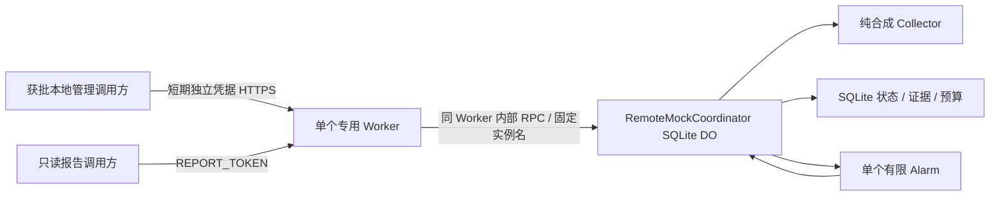

# 隔离远程架构（候选）

不新增第二个管理 Worker。直接从本机通过 Cloudflare REST 调用任意 DO RPC 不受支持；单独的内部 Service Binding 调用方仍需要可信触发入口且多一个资源。因此候选方案是在同一 Worker 内设临时、严格鉴权的管理桥，必须由用户单独批准暴露面。

候选 Worker `us-stocks-p51b-mock-20261113`；SQLite 类 `RemoteMockCoordinator`；实例名 `phase51b-synthetic-20261113-v1`。账户核验前名称只是候选，不能覆盖已有对象。

`cloudflare.config.ts` 继续由 cf Beta/Vite 构建。显式 `--mode p51b-mock` 选择独立入口 `src/remote-worker.ts`；默认模式保留本地 Phase 5.1 入口。远程模式的 `REMOTE_MOCK_ENABLED` 为 `DISABLED_PENDING_GATE_B`，没有任何 Secret、对象 ID 或初始化启用绑定。

远程 bundle 图只包含计算/检查点/存储/API、合成 Collector 与隔离 adapter；没有 `src/mock.ts`、`fixtures/`、Python 状态或旧事件。Calendar 是规则日历，允许随包分发。Golden 归档只在本地回归中使用。

没有 scheduled handler、Cron、外部行情 fetch、R2、静态资产、生产 route 或域名。唯一预计应用 URL 是待确认账户的 `https://us-stocks-p51b-mock-20261113.<approved-subdomain>.workers.dev`。workers.dev 设置及其他项目隔离仍需账户只读核验。
